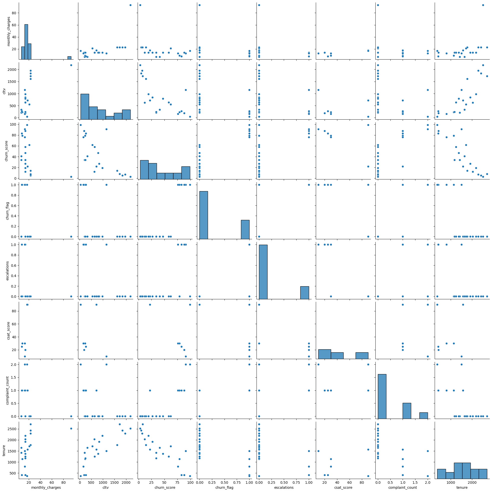

# 📉 Customer Churn – Exploratory Data Analysis (SQLite + Python)

End-to-end EDA project that loads customer data from a **SQLite database**, cleans and merges three tables, engineers a churn flag, and calculates key business metrics such as churn rate, ARPU, average tenure, revenue at risk and escalation rate, followed by visualisations.

---

## 📌 Project Overview

A subscription business wants to understand **who is leaving and why**. This notebook takes three raw tables (customer, subscription, support), builds one analysis-ready dataset, and answers core churn questions using Pandas, Matplotlib and Seaborn.

**Why SQLite?** The dataset is small and this is a portfolio project, so a lightweight, serverless database was enough. For a larger production system with concurrent users, I would use a server-based database such as MySQL or SQL Server.

---

## 🗂️ Dataset

Database file: `customer_churn.db` (21 customers)

| Table | DataFrame | Description |
|---|---|---|
| `db_customer` | `df1` | Customer demographics (name, gender, dob, state, country, interests) |
| `db_subscription` | `df2` | Plan type, subscription type, contract type, monthly charges, CLTV, churn score, start / renewal / cancellation dates |
| `db_support` | `df3` | Support tickets (complaint date, escalations, CSAT score, comment) |

All tables are linked through `customerid`.

---

## 🔧 Workflow

### 1. Data loading
- Connected to SQLite using `sqlite3`.
- Used the `sqlite_master` system table to fetch table names **dynamically**, so no table name is hard-coded.
- Looped over the tables and created one DataFrame per table.

### 2. Data cleaning
**Customer table**
- Dropped `pincode` (100% null)
- Renamed `name` → `customer_name`
- Standardised `gender` (`Women` → `Female`, `Men` → `Male`)
- Converted `dob` to datetime
- Filled 3 missing `country` values by mapping from `state`

**Subscription table**
- Converted `subscription_start_date`, `renewal_date`, `cancellation_date` to datetime

**Support table**
- Dropped the empty `col_1` column
- Converted `complaint_date` to datetime

### 3. Feature engineering
- **`churn_flag`**: `1` if a `cancellation_date` exists, else `0`
- **`complaint_count`**: number of complaints per customer (`groupby` + `transform`)
- **`tenure`**: days from subscription start to cancellation (or to today for active customers)

### 4. Merging & data-quality check
- Left-joined subscription ← customer ← support.
- **Issue found:** the first merge returned **23 rows instead of 21**. The support table had duplicate `customerid` values (9 tickets for 7 customers).
- **Fix:** calculated `complaint_count` first, then sorted by `complaint_date` and kept only the latest ticket per customer. After re-merging, the shape is **(21, 23)**, which matches the base table.
- Customers with no tickets got `complaint_count = 0`.
- Final dataset exported to `churn.csv`.

> 💡 Always compare the shape of the final dataset with the base (left) table after every join.

---

## 📊 Key Results

| Metric | Result |
|---|---|
| **Overall churn rate** | **28.57%** (6 of 21 customers) |
| **ARPU** (average monthly charges) | 18.85 |
| **Average tenure** | ~1,554 days |
| **Revenue at risk** (monthly charges of churned customers) | 73.94 |
| **Escalation rate** | 19.05% |
| **Avg complaints per customer** | 0.43 |
| **Correlation (escalation ↔ churn)** | 0.77 (strong positive) |

### Churn by plan type

| Plan | Customers | Churn rate |
|---|---|---|
| Basic | 5 | **60.0%** |
| Standard | 9 | 22.2% |
| Premium | 7 | 14.3% |

### Churn by state
Karnataka (100%), Meghalaya (66.7%), Telangana (50%) and Delhi (25%) have churn. All other states (Maharashtra, Nagaland, Rajasthan, Uttar Pradesh, Kathmandu) have 0%.

### 🔍 Insights
- **Basic plan customers churn the most** (60%), while Premium customers are the most loyal.
- **Escalated complaints are strongly linked to churn** (correlation ≈ 0.77), so unresolved support issues are a key churn driver.
- Churn is concentrated in a few states, but the sample is very small, so state-level numbers should be read with caution.

   

> ⚠️ **Note:** The dataset has only 21 customers, so these results are indicative, not statistically conclusive.

---

## 📈 Visualisations

- Monthly churn trend (line chart)
- Churn rate by plan type (bar chart)
- Churn rate by state (bar chart)
- Correlation heatmaps (plan type, contract type, churn score, escalations vs churn)
- Pairplot of numeric features
- Catplot: monthly charges by plan type, split by gender and churn status
- Pivot table: churn rate, customer count and total charges per plan

---

## 🛠️ Tech Stack

- Python 3
- Pandas, NumPy
- Matplotlib, Seaborn
- SQLite (`sqlite3`)
- Jupyter Notebook

---

## 🔮 Future Improvements

- Build a churn prediction model (Logistic Regression, Random Forest)
- Analyse CSAT score and complaint comments in more depth
- Repeat the analysis on a larger dataset
- Build an interactive dashboard in Power BI or Tableau

---

